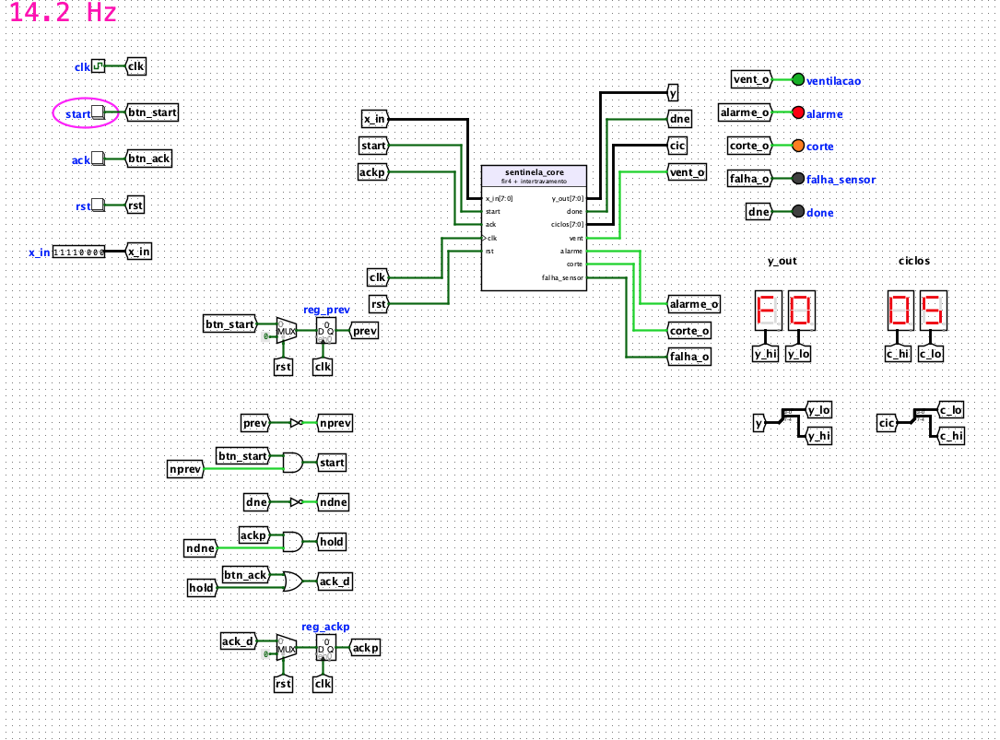

# SENTINELA — Do circuito digital ao IP Core

**Nó sensor de borda em Logisim: filtro FIR em ponto fixo, detecção de falha do sensor e intertravamento seguro de um gerador a diesel.**

**Autores e colaboradores acadêmicos:**

| Integrante | GitHub | Vinculação |
|---|---|---|
| **Ezequias Ferreira** | [@ezequiasferreira](https://github.com/ezequiasferreira) | Coautor |
| **Marcelo Barbosa** | [@marcelobns](https://github.com/marcelobns) | Coautor |

**Disciplina:** Arquitetura e Organização de Computadores — PPCA/UFRR  
**Professor:** Herbert Oliveira Rocha · **Data:** 03/11/2026

> **Validação:** os cinco subcircuitos testáveis passaram nos 1097 vetores de teste no Logisim-evolution 5.0.0, e o `main` passou em 138/138 numa bancada com pinos e foi operado no GUI. Os pontos ambíguos do roteiro estão marcados com **[VERIFICAR]** e aguardam confirmação do professor. A compatibilidade com versões anteriores à 5.0.0 não foi testada.



**[Relatório (PDF)](docs/relatorio_sentinela.pdf)** · **[Tabela de transição](docs/fsm_tabela_transicao.md)** · **[Arquitetura e decisões](docs/02-arch.md)** · **[Requisitos](docs/01-prd.md)** · **[Evidências](docs/evidencias/)** · **[Pontos a confirmar](docs/verificar_professor.md)** · **[Roteiro](docs/Lab_Logisim_SENTINELA.pdf)**

## Proposta

Um gerador a diesel alimenta o laboratório de uma escola ribeirinha, sem supervisão permanente. O SENTINELA lê a temperatura do bloco do motor, filtra o ruído elétrico, detecta sensor fora de faixa ou congelado e executa a sequência **ventilação → alarme → corte → rearme manual**, medindo quantos ciclos de relógio gasta por amostra. Cada etapa é um subcircuito reutilizável, na disciplina de um IP Core.

| Recurso | SENTINELA |
|---|---|
| Amostras | 8 bits sem sinal; 0–255 ≙ 0,0–127,5 °C, passo de 0,5 °C |
| Coeficientes | Q1.7 em ROM 4 × 8: h = {16, 48, 48, 16}, Σh = 128 (ganho unitário) |
| Relógio e reset | Clock único no `main`; `rst` síncrono, ativo em nível alto |
| Latência do filtro | 5 ciclos por amostra (`ciclos = 5`), `done` por exatamente 1 ciclo |
| Limiares | T_VENT 0xB4 (90 °C) · T_CORTE 0xD2 (105 °C) · T_FAIXA_MAX 0xF0 (120 °C) · N_CONGELADO 8 |
| Controle | FSM de Moore hardwired, 3 bits; estados 101–111 vão para FALHA |
| Ferramenta | Logisim-evolution 5.0.0 (o roteiro pede ≥ 3.8) |

## Subcircuitos

| Etapa | Subcircuito | Entradas | Saídas |
|---|---|---|---|
| 1 | `alu8` | `a[8]` `b[8]` `op[2]` | `y[8]` `zero` `carry` |
| 1 | `regs2` | `din[8]` `we` `sel` `clk` `rst` | `r0_out[8]` `r1_out[8]` |
| 2 | `fir4` | `x_in[8]` `start` `clk` `rst` | `y_out[8]` `done` `ciclos[8]` |
| 3 | `intertravamento` | `temp[8]` `amostra_ok` `ack` `clk` `rst` | `vent` `alarme` `corte` `falha_sensor` |
| — | `sentinela_core` | `x_in[8]` `start` `ack` `clk` `rst` | `y_out[8]` `done` `ciclos[8]` `vent` `alarme` `corte` `falha_sensor` |
| — | `main` | Clock e Buttons | LEDs e displays hexadecimais |

`op`: `00` ADD, `01` SUB (carry = empréstimo), `10` AND, `11` SHR. Os nomes dos pinos são o contrato do IP Core: o Test Vector casa as colunas pelo label. O `sentinela_core` integra `fir4` e `intertravamento` com pinos, para que a integração (caso 10) seja testável por vetores; o `main` só cuida da E/S.

**Estados:** NORMAL `000` → VENT `001` → ALARME `010` → CORTE `011`; FALHA `100` tem prioridade. Uma decisão por amostra (`amostra_ok`); CORTE e FALHA só saem por `ack`. A tabela completa está em [fsm_tabela_transicao.md](docs/fsm_tabela_transicao.md).

## Execução dos testes

Pré-requisitos: **Logisim-evolution 5.0.0** (o script usa o `.jar` instalado em `/Applications`; outro caminho vai em `LOGISIM_JAR`), **Java** e **Python 3.10+**, sem bibliotecas externas.

```bash
scripts/rodar_testes.sh          # os cinco vetores
scripts/rodar_testes.sh fir4     # só um subcircuito
python3 ref/sentinela_ref.py --check
tools/testar_bancada.sh          # main numa cópia com pinos no lugar de Clock e Buttons
```

O esperado é **alu8 15/15, regs2 18/18, fir4 380/380, intertravamento 438/438 e sentinela_core 246/246**, além de 138/138 na bancada do `main`. Os logs ficam em `tests/resultados/`. No GUI, abra o subcircuito com duplo clique e use **Simulate → Test Vector…** com o `.txt` correspondente de `tests/`.

Nos vetores sequenciais, cada caso é um `<set>` que começa com `rst = 1`, e cada ciclo ocupa duas linhas: `clk = 0` (saídas antes da borda) e `clk = 1` (saídas depois da borda de subida). `<DC>` marca uma saída não verificada naquela linha.

## Operação do `main`

Os botões só são vistos numa borda de subida do relógio: **pressione e segure** cada um por cerca de 1 s. Segurar o `start` não gera várias amostras, porque o circuito tem pulso único.

1. Com o `main` aberto, use **Simulate → Reset Simulation**, escolha **Auto-Tick Frequency** (4 a 32 Hz) e ligue **Auto-Tick Enabled** (`⌘K`).
2. Selecione a ferramenta de mão (Poke Tool, `⌘1`); com a seta, um clique edita o componente.
3. Segure **rst** e defina `x_in` clicando nos bits (por exemplo, `11110000` = `F0` = 120 °C).
4. Segure **start** a cada amostra. Em CORTE ou FALHA, segure **ack**: o rearme acontece no `done` da amostra seguinte.

Com `x_in = F0`, cinco amostras levam o sistema por **NORMAL, NORMAL, VENT, ALARME e CORTE** (`y_out` = `1E`, `78`, `D2`, `F0`, `F0`; `ciclos = 05`). Na 11ª amostra igual, o detector de congelamento leva a FALHA: é o falso positivo discutido no relatório.

## Regeneração

Os vetores são gerados pelo modelo de referência ciclo a ciclo, e o `sentinela.circ` pelos scripts de `tools/`. Nenhum dos dois deve ser editado à mão, nem pelo GUI.

```bash
python3 ref/sentinela_ref.py     # confere as contas do roteiro e reescreve tests/*.txt
tools/regenerar.sh               # regera os seis circuitos e roda o lint de layout
```

Cada `tools/build_*.py` gera um subcircuito, incluindo a aparência personalizada; quem instancia um subcircuito lê as portas dessa aparência no próprio `.circ`, por isso o `regenerar.sh` gera os blocos antes de quem os usa. Para mudar uma decisão do roteiro, mude o modelo, regenere os vetores e ajuste o circuito até eles passarem.

## Entregáveis

- **Projeto Logisim:** [`sentinela.circ`](sentinela.circ), com `alu8`, `regs2`, `fir4`, `intertravamento`, `sentinela_core` e `main`, todos com aparência personalizada.
- **Vetores de teste:** [`tests/`](tests/), um arquivo por subcircuito (`test_alu8`, `test_regs2`, `test_fir4`, `test_fsm`, `test_sentinela`).
- **Evidências:** [`docs/evidencias/`](docs/evidencias/), com o Test Vector de cada subcircuito (`<nome>_test.png`), os circuitos (`<nome>_circuito.png`) e o `main` em simulação com `ciclos` visível (`main_simulacao.png`).
- **Relatório:** [`docs/relatorio_sentinela.pdf`](docs/relatorio_sentinela.pdf), 2 páginas, com a tabela de transição, as reflexivas das Etapas 1 a 3 e a ponte para o PTT4; a fonte editável é o `.docx` ao lado.

## Status de verificação

| Etapa | Estado |
|---|---|
| Especificação, errata e decisões do roteiro | Documentadas |
| Modelo de referência e vetores (1097) | Testados |
| `main` em bancada (138) e no GUI | Testado |
| Evidências e relatório | Entregues |
| Pontos [VERIFICAR] com o professor | Pendente |
| Compatibilidade com Logisim < 5.0.0 | Não testada |
| Controle microprogramado e `sequenciador` (bônus) | Não realizados |

**Nota:** o caso 5 do `fir4` vale **0x9E**, e não "≤ 0x80" como no roteiro: o pico cai num tap de peso 48. O pico ainda assim não liga a ventilação (0x9E < T_VENT). Esta e as demais decisões sobre pontos ambíguos estão no [Apêndice A da arquitetura](docs/02-arch.md#apêndice-a-registro-de-decisões-do-roteiro).
