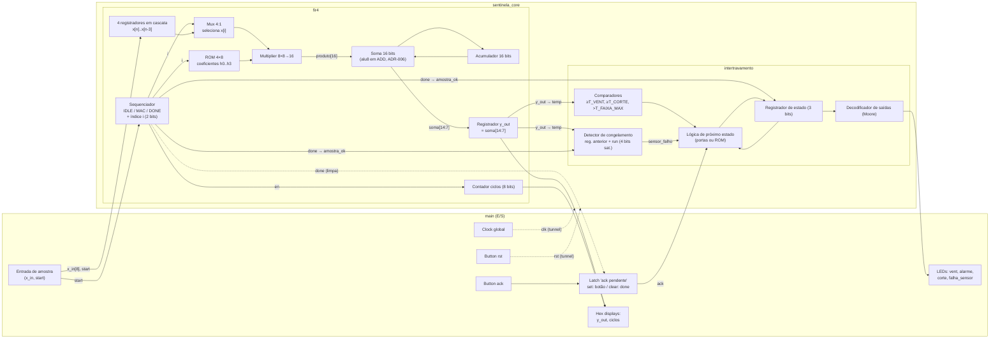
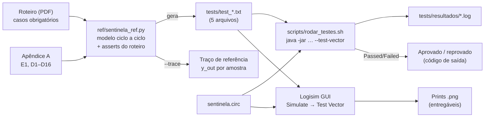

# Arquitetura e Princípios — SENTINELA

O contexto de produto, as personas, as regras de negócio e os casos de uso estão em
[docs/01-prd.md](01-prd.md). Este documento trata de como o sistema é construído: os blocos de
hardware, o fluxo de dados e de controle, a cadeia de verificação, a ferramenta e os princípios
de arquitetura. A errata e as interpretações do roteiro (E1, D1 a D16) estão no
[Apêndice A](#apêndice-a-registro-de-decisões-do-roteiro), ao final deste documento.
A tabela de transição completa da FSM está em [fsm_tabela_transicao.md](fsm_tabela_transicao.md).

## Componentes

O sistema tem duas partes. O **hardware** é um único projeto Logisim com um subcircuito por bloco.
A **cadeia de verificação** gera e executa os vetores de teste fora do Logisim.

### Hardware (`sentinela.circ`)

| Subcircuito       | Natureza                   | Responsabilidade                                                                        |
| ----------------- | -------------------------- | --------------------------------------------------------------------------------------- |
| `alu8`            | Combinacional              | ADD, SUB, AND e SHR de 8 bits, com flags `zero` e `carry`; átomo aritmético reutilizável |
| `regs2`           | Sequencial                 | Dois registradores de 8 bits com escrita seletiva (`we`, `sel`)                         |
| `fir4`            | Sequencial (datapath + FSM) | Filtro FIR de 4 taps em Q1.7, com um MAC sequencial e o contador de ciclos              |
| `intertravamento` | Sequencial (FSM Moore)     | Detecção de falha do sensor e escalada NORMAL → VENT → ALARME → CORTE / FALHA           |
| `sentinela_core`  | Estrutural                 | Liga o `fir4` ao `intertravamento`; é a menor unidade integrada que pode ser testada    |
| `main`            | Estrutural + E/S           | Clock global, botões, entrada de amostra, LEDs e displays; pulso único no `start` e latch de rearme (D10) |
| `sequenciador`    | —                          | Etapa 4 (bônus); sem especificação no roteiro                                           |

### Cadeia de verificação

| Artefato                  | Ambiente             | Responsabilidade                                                                    |
| ------------------------- | -------------------- | ----------------------------------------------------------------------------------- |
| `ref/sentinela_ref.py`    | Python ≥ 3.10 (stdlib) | Modelo de referência ciclo a ciclo; confere as contas do roteiro; gera os vetores |
| `tests/test_*.txt`        | Logisim Test Vector  | Estímulos e respostas esperadas, um arquivo por subcircuito testável                |
| `scripts/rodar_testes.sh` | Bash + Java          | Executa todos os vetores pelo modo `--test-vector` e decide a aprovação (D16)       |
| `tests/resultados/*.log`  | —                    | Saída detalhada de cada execução, com a diferença sinal a sinal (não versionada)    |

## Fluxo de dados

### Hierarquia e sinais entre blocos



### Interface entre `fir4` e `intertravamento`

O acoplamento entre os dois blocos é um handshake de um ciclo: `done` funciona como "dado
válido" e `y_out` é o dado. O contrato é:

- `y_out` é um registrador, não um fio do acumulador. Ele fica estável durante todo o ciclo em que
  `done = 1` e continua estável depois disso, até a próxima amostra (ADR-005).
- O `intertravamento` amostra `temp` e `amostra_ok` na mesma borda. Por isso, a decisão sobre uma
  amostra acontece na borda que encerra o ciclo `DONE` do filtro.
- Nenhum outro sinal cruza a fronteira, e o `intertravamento` não conhece a latência do filtro.

### Caminho de uma amostra

Com a latência de referência 5 (D5), cada amostra ocupa 6 ciclos, da borda do `start` até a
decisão da FSM:

1. **E0.** `start` chega com o sequenciador em IDLE. O shift register incorpora `x_in`, o
   acumulador e o índice são zerados, `ciclos ← 1`, e o estado vai para MAC.
2. **E1 a E4.** Em cada borda, o mux escolhe `x[i]`, a ROM fornece `h[i]`, o multiplicador gera o
   produto e o somador o acumula. O índice e o contador de ciclos avançam.
3. **E4** (último tap). O registrador `y_out` captura `soma[14:7]`, que já inclui o último produto,
   e o sequenciador entra em DONE.
4. **Ciclo DONE.** `done = 1`, e `y_out` e `ciclos = 5` estão válidos.
5. **E5.** Os comparadores e o detector de congelamento avaliam `temp`. O registrador de estado
   (habilitado por `amostra_ok`) recebe o próximo estado; `anterior` e `run` são atualizados; o
   sequenciador volta a IDLE.
6. **Depois de E5.** O decodificador Moore atualiza os LEDs. `y_out` e `ciclos` ficam congelados
   até o próximo `start`.

### Cadeia de verificação



## Módulos internos

Esta é a organização interna proposta para cada subcircuito. Os componentes são os do Logisim
Evolution. As escolhas que não são óbvias estão nas ADRs.

| Subcircuito       | Elementos internos                                                                                                     | Papel                                                                 |
| ----------------- | ---------------------------------------------------------------------------------------------------------------------- | --------------------------------------------------------------------- |
| `alu8`            | Adder, Subtractor, AND 8 bits, Splitter (SHR por fiação), Multiplexer 4:1 × 8 bits para `y`, Multiplexer 4:1 × 1 bit para `carry`, Comparator contra 0 | As 4 operações são calculadas em paralelo; `op` só seleciona |
| `regs2`           | 2 Registers de 8 bits, mux de reset na entrada D, lógica de enable `rst ∨ (we ∧ sel = k)`                              | Armazenamento endereçável mínimo                                      |
| `fir4`: datapath  | 4 Registers de 8 bits em cascata (o componente Shift Register só tem *clear* assíncrono), ROM 4 × 8 (coeficientes), Mux 4:1, Multiplier, soma de 16 bits, acumulador de 16 bits, registrador `y_out` | Convolução sequencial, um tap por ciclo                   |
| `fir4`: controle  | Registrador de estado de 2 bits (IDLE, MAC, DONE), índice `i` e `ciclos` como registrador + Adder (+1), todos com reset síncrono | Sequencia o MAC, gera `done`, instrumenta a latência                  |
| `intertravamento` | 3 Comparators (unsigned) contra Constants, Comparator de igualdade, registrador `anterior` (8 bits), contador `run` (registrador de 4 bits + Adder + mux de saturação), lógica de próximo estado, registrador de estado (3 bits), decodificador de saídas | Decisão de segurança por amostra |
| `sentinela_core`  | Uma instância de `fir4` e uma de `intertravamento`                                                                      | Integração testável por vetores                                       |
| `main`            | Clock, Buttons (`start`, `ack`, `rst`), entrada de 8 bits para `x_in`, latch de `ack`, LEDs, Hex Digit Displays       | Operação manual e demonstração                                        |

### Contrato de sinais por subcircuito

Os nomes e larguras dos pinos estão no [README](../README.md#interfaces-dos-subcircuitos). Eles
são o contrato do IP Core: os vetores casam as colunas pelo label do pino.

### Registradores com reset síncrono

Todo elemento de estado segue o mesmo padrão (ADR-003):

```text
D      = rst ? 0 : próximo_valor
enable = rst ∨ condição_de_escrita
```

No `intertravamento`, o registrador de estado usa
`D = rst ? 000 : (estado_inválido ? 100 : próximo_estado)` e
`enable = rst ∨ amostra_ok ∨ estado_inválido` (ADR-008).

## Observabilidade

Em hardware simulado, a observabilidade significa conseguir ver e comparar sinais.

- **Test Vectors.** Cada falha mostra o vetor, o sinal, o valor obtido e o esperado. Os logs ficam
  em `tests/resultados/<subcircuito>.log`.
- **Traço de referência.** `python3 ref/sentinela_ref.py --trace` imprime o `y_out` esperado por
  amostra. Compare com a exportação de **Simulate → Logging** do Logisim sobre `y_out` e `done`.
- **Estado da FSM sem pino de depuração.** As saídas Moore são distintas por estado (0000, 1000,
  1100, 1110, 1111), então observar os 4 LEDs basta para identificar o estado.
- **Desempenho.** `ciclos` vai para um Hex Digit Display no `main`. O print do `main` com `ciclos`
  visível é um entregável.
- **Inspeção pontual.** Use o Poke Tool para examinar registradores internos e o Probe para
  barramentos intermediários (produto, acumulador, índice). É também assim que se demonstra o
  tratamento dos estados inválidos (D12).

## Stack

### Ferramentas e versões

| Camada              | Ferramenta              | Versão                              |
| ------------------- | ----------------------- | ----------------------------------- |
| Hardware            | Logisim-evolution       | 5.0.0 (o roteiro pede ≥ 3.8; D16)   |
| Execução do Logisim | Java                    | 25 (JRE do sistema)                 |
| Modelo de referência | Python                 | ≥ 3.10, só biblioteca padrão        |
| Automação           | Bash                    | 3.2+ (padrão do macOS)              |
| Versionamento       | Git                     | —                                   |

### Hardware (`sentinela.circ`)

- **Bibliotecas Wiring, Gates, Plexers, Arithmetic e Memory do Logisim.** Ficamos nos componentes
  básicos, de propósito: o objetivo é expor a estrutura (datapath versus controle) e não esconder
  lógica em componentes de alto nível.
- **Multiplier 8×8.** A metade alta do produto sai no pino *carry out*, e as duas metades são
  reunidas com um Splitter (D6).
- **ROM para os coeficientes.** Ela torna o filtro parametrizável por conteúdo, que é a diferença
  entre um bloco "fixo" e um "parametrizável" no vocabulário de IP Core.
- **Constant para os limiares.** Ajustar T_VENT, T_CORTE, T_FAIXA_MAX ou N_CONGELADO não altera a
  lógica.
- **Tunnels para `clk`, `rst` e barramentos longos**, como manda a convenção do roteiro.

### Cadeia de verificação

- **`ref/sentinela_ref.py`.** Modela cada bloco como uma classe com `saidas()` (combinacional sobre
  o estado) e `borda()` (transição na subida do clock). Assim, o modelo tem a mesma separação
  Moore/registrador do hardware, e cada linha de vetor sai diretamente do modelo. Os `assert`
  comparam o modelo com os valores do roteiro antes de qualquer arquivo ser escrito.
- **Test Vector do Logisim com `<set>`, `<seq>` e `<DC>`.** Os testes sequenciais preservam o
  estado dentro de um set e resetam entre sets. `<DC>` permite verificar `y_out` e `ciclos` só
  quando `done = 1`.
- **`scripts/rodar_testes.sh`.** Decide a aprovação pela linha `Passed/Failed`, porque o código de
  saída do Logisim 5.0.0 não é confiável (D16).

### Armazenamento

| Elemento                          | Tipo                         | Uso                                                |
| --------------------------------- | ---------------------------- | -------------------------------------------------- |
| ROM de coeficientes (`fir4`)      | ROM 4 palavras × 8 bits      | h0..h3 em Q1.7; padrão {16, 48, 48, 16}           |
| Constants de limiar               | Constant 8 bits / 4 bits     | T_VENT, T_CORTE, T_FAIXA_MAX, N_CONGELADO         |
| ROM de próximo estado (opcional)  | ROM 128 palavras × 3 bits    | Controle microprogramado ([fsm_tabela_transicao.md](fsm_tabela_transicao.md)) |

### Convenções

- Os nomes de sinais usam snake_case e são idênticos aos labels dos pinos e às colunas dos vetores.
- Cada subcircuito tem as entradas à esquerda, as saídas à direita e aparência personalizada.
- Os barramentos têm a largura explícita no vetor (`x_in[8]`), e os valores de 8 bits estão em hex
  (`0x9E`).
- Nos vetores sequenciais, cada ciclo ocupa duas linhas (`clk = 0` e `clk = 1`) com as mesmas
  entradas, e cada caso é um `<set>` que começa com `rst = 1` (ADR-002).
- Toda mudança de estado ocorre na borda de subida do clock global.

## Princípios de arquitetura

- **O modelo de referência é a fonte da verdade.** Os vetores são gerados a partir do
  `sentinela_ref.py` e nunca editados à mão. Uma mudança de comportamento começa no modelo, e um
  `.txt` editado à mão é sobrescrito na próxima geração.
- **A interface é o contrato do IP Core.** Mudar um nome, largura ou semântica de pino exige
  atualizar juntos o modelo, os vetores, o README e o esqueleto do `.circ`; caso contrário, os
  vetores daquele bloco quebram.
- **Um clock, uma borda, nenhum caminho assíncrono.** Os pinos *clear* assíncronos do Logisim não
  são usados. Um reset assíncrono faz o vetor que confere `rst = 1` com `clk = 0` falhar.
- **Decisões por amostra, não por ciclo.** Todo estado do `intertravamento` (estado, `anterior`,
  `run`) só avança com `amostra_ok`. Um contador que avança por ciclo é reprovado pelos vetores, que
  intercalam ciclos sem amostra.
- **Seguro por construção.** A falha do sensor é testada antes de qualquer outra condição, e
  qualquer código de estado inválido leva às saídas de FALHA. Uma ordem de prioridade invertida é
  reprovada pelos casos 7e e 9.
- **Parametrizar por dados, não por portas.** Coeficientes ficam na ROM e limiares em Constants.
  Um valor embutido em portas lógicas impede trocar o filtro ou recalibrar sem redesenho (UC-009 do
  PRD).
- **Tudo o que precisa de teste tem pinos.** A lógica de produto mora em subcircuitos com pinos. O
  `main` só faz E/S, o pulso único do `start` e o latch de rearme, porque não pode ser testado por
  vetores.

## Diretrizes de desenvolvimento

O fluxo de trabalho e os comandos estão no [README](../README.md). Resumo:

- Implemente de baixo para cima: `regs2` → `alu8` → `fir4` → `intertravamento` →
  `sentinela_core` → `main`. O `regs2` é o primeiro porque valida a convenção de relógio dos
  vetores com o menor circuito possível.
- Antes de cada commit, rode `scripts/rodar_testes.sh`. Um commit por bloco aprovado facilita
  mostrar a evolução no repositório.
- Para mudar uma decisão, registre-a no Apêndice A (ou na ADR correspondente), altere o modelo, regenere com
  `python3 ref/sentinela_ref.py` e rode os testes.
- Salve os prints de evidência com nomes estáveis (`print_alu8.png`, `print_fir4.png`…) numa pasta
  versionada.

## Decisões de arquitetura

As ADRs abaixo registram as escolhas estruturais. As decisões de interpretação do roteiro estão
no [Apêndice A](#apêndice-a-registro-de-decisões-do-roteiro); quando uma delas tem consequência
estrutural, o apêndice aponta para a ADR. Se a lista de ADRs passar de dez itens ou precisar de
histórico, migre para `docs/decisions/ADR-NNN.md`.

### ADR-001 — Modelo de referência executável como gerador dos vetores

**Status:** aceita  
**Contexto:** São 1097 vetores, e boa parte depende da temporização ciclo a ciclo. O roteiro tem uma
errata e várias ambiguidades, e algumas delas podem mudar depois de uma conversa com o professor.  
**Decisão:** Os vetores são gerados por um modelo Python ciclo a ciclo, que antes confere as contas
do roteiro com `assert`.  
**Justificativa:** Escrever os vetores à mão seria inviável e frágil: mudar a latência do filtro
alteraria centenas de linhas. O modelo também produz o "traço de referência" que o roteiro pede.  
**Consequências:** Uma decisão nova exige mudar código Python, não texto. O modelo precisa
espelhar a temporização do hardware; se divergirem, os vetores falham, mesmo com um circuito
funcionalmente correto.

### ADR-002 — `clk` como pino de entrada e duas linhas por ciclo

**Status:** aceita  
**Contexto:** Um Test Vector só controla pinos. Um componente Clock dentro do subcircuito avança
com os ticks do simulador e não pode ser sincronizado com os estímulos.  
**Decisão:** Os subcircuitos recebem `clk` por pino, e o Clock global fica só no `main`. Cada ciclo
vira duas linhas de vetor: `clk = 0` com entradas novas, depois `clk = 1` com as mesmas entradas.  
**Justificativa:** Nenhuma entrada muda no instante da borda, o que evita a corrida que a própria
documentação do Logisim desaconselha. A linha com `clk = 0` verifica o estado antes da borda, e a
com `clk = 1`, o estado depois dela.  
**Consequências:** Os vetores ficam com o dobro de linhas. A convenção foi confirmada num
circuito real com o `regs2` (18 de 18 vetores). Os mesmos vetores reprovam versões com defeitos
plantados: reset assíncrono, `sel` invertido e registrador sensível à borda de descida.

### ADR-003 — Reset síncrono pelo caminho de dados

**Status:** aceita  
**Contexto:** O roteiro exige reset síncrono, mas o *clear* do Register e do Counter no Logisim é
assíncrono (D13).  
**Decisão:** O reset entra pelo D (mux com Constant 0) ou pelo *load* de 0, junto com o enable. O
pino *clear* fica sem uso.  
**Justificativa:** É a única forma de cumprir a convenção com os componentes padrão. Os vetores
verificam o comportamento.  
**Consequências:** Há um mux a mais por registrador, e o `rst` precisa entrar no enable de todo
elemento de estado.

### ADR-004 — `sentinela_core` como unidade de integração testável

**Status:** aceita  
**Contexto:** O caso 10 do roteiro é um teste de integração (`fir4` + `intertravamento`), mas o
`main` usa botões e LEDs, que um Test Vector não controla (D15).  
**Decisão:** Criar o subcircuito `sentinela_core`, com pinos, contendo a integração. O `main` só
instancia o core e cuida da E/S.  
**Justificativa:** A integração fica verificável automaticamente, e o `main` fica reduzido a
fiação, que se inspeciona a olho.  
**Consequências:** Há um subcircuito e um arquivo de vetores a mais do que os entregáveis listados
no roteiro, o que precisa ser explicado no README e no relatório.

### ADR-005 — `y_out` registrado e válido durante `done`

**Status:** aceita  
**Contexto:** O roteiro descreve "ciclo 5: `y_out ← acc >> 7`; `done = 1`". Se `y_out` só fosse
carregado na borda do fim do ciclo DONE, a FSM, que amostra na mesma borda, leria o valor anterior.  
**Decisão:** O registrador `y_out` captura `soma[14:7]` na borda do último tap (E4), junto com a
entrada em DONE. Durante o ciclo DONE, `y_out` já é o resultado novo.  
**Justificativa:** `done` vira um "dado válido" de verdade, e a integração não precisa de lógica
extra nem de um ciclo de atraso.  
**Consequências:** O registrador `y_out` lê a saída do somador, não do acumulador. Uma
implementação com outra temporização precisa regenerar os vetores (`FIR_LATENCIA`) e manter esse
contrato.

### ADR-006 — Soma de 16 bits do acumulador

**Status:** aceita (D3); implementada no `fir4`  
**Contexto:** O acumulador tem 16 bits e a `alu8` tem 8, sem `cin`. O roteiro sugere encadear duas
`alu8` pelo carry, o que não fecha com essa interface.  
**Decisão:** Usar três `alu8` em modo ADD, sem mudar a interface:
`lo = acc_lo + p_lo`, `h1 = acc_hi + p_hi` e `hi = h1 + {0000000, carry_lo}`.  
**Justificativa:** Mantém o `test_alu8.txt` e o contrato da `alu8` intactos, e mantém a fidelidade
ao IP Core (reaproveitar a ALU). O acumulador nunca passa de 32640, então não há estouro no topo.  
**Alternativas:** Acrescentar `cin` à `alu8`, o que muda a interface e exige acrescentar uma
coluna `cin` (com 0) em `gerar_alu8()` antes de regenerar os vetores. Ou usar um Adder de 16 bits
(opção b do roteiro): mais simples, mas menos fiel ao reaproveitamento pedido.  
**Consequências:** A cadeia de carry atravessa três ALUs em série, o que aumenta o caminho crítico.
Esse é um bom ponto para a pergunta reflexiva sobre área e latência.

### ADR-007 — Detector de congelamento por tamanho de sequência, com contador saturante

**Status:** aceita  
**Contexto:** A dica do roteiro ("o contador incrementa se igual, reseta se diferente", com limiar
≥ 8) conta igualdades. Só que 8 amostras iguais geram 7 igualdades, então a FALHA sairia na 9ª
amostra, e o caso 8 exige a 8ª (D9).  
**Decisão:** `run` conta as amostras idênticas seguidas, incluindo a atual: se a amostra é
diferente da anterior, `run = 1`; se é igual, `run + 1`. O contador tem 4 bits e satura em 15. Ele
é um registrador com reset síncrono, um Adder (+1) e um mux que mantém o valor quando o carry-out
do Adder indica 15; o Counter do Logisim (*Action on Overflow: Stay at value*) faria o mesmo, mas
seu *clear* é assíncrono. `anterior` e `run` só avançam com `amostra_ok`, e
a comparação usa `run_prox` (combinacional), de modo que a falha sai na própria 8ª amostra. Como
`anterior = run = 0` no reset, a primeira amostra sempre dá `run = 1`, inclusive quando vale 0x00.  
**Justificativa:** O limiar fica igual ao N do roteiro, sem "N − 1" escondido. Um contador de 3
bits daria a volta em 7; com saturação, a falha também não some depois de 16 repetições (há um
vetor com 20 amostras iguais e `ack` insistente para garantir isso).  
**Consequências:** A lógica de `sensor_falho` depende de um valor combinacional (`run_prox`), não só
do registrador, e isso acrescenta um somador de 4 bits ao caminho até o próximo estado.

### ADR-008 — Estados inválidos vão para FALHA sem depender de `amostra_ok`

**Status:** aceita  
**Contexto:** Com 3 bits de estado e 5 estados, sobram 101, 110 e 111. O enable normal do
registrador de estado é `amostra_ok` (D12).  
**Decisão:** O enable do registrador de estado inclui `estado_inválido`, e o decodificador de
saídas entrega 1111 para qualquer código inválido.  
**Justificativa:** Esperar uma amostra válida para sair de um estado inválido deixaria o sistema em
condição indefinida por um período inteiro de amostragem. Com isso, o tempo de recuperação é de um
ciclo, com saídas seguras desde o primeiro instante.  
**Consequências:** O enable deixa de ser um único sinal. Esse comportamento não pode ser testado
por vetores e é demonstrado no GUI.

### ADR-009 — Latch de rearme no `main`, fora do core

**Status:** aceita  
**Contexto:** O `ack` só é considerado junto com `amostra_ok` (D10), e um Button do Logisim só vale
1 enquanto está pressionado.  
**Decisão:** No `main`, um registrador "ack pendente" é setado pelo botão e limpo por `done`. A
saída desse registrador alimenta o pino `ack` do core.  
**Justificativa:** O operador não precisa segurar o botão até a próxima amostra, e o comportamento
do core continua sendo o especificado pelos vetores.  
**Consequências:** O `main` ganha lógica sequencial que os vetores não cobrem: este latch e o
pulso único do `start` (um registrador com o valor anterior do botão; `start = botão ∧ ¬anterior`),
que impede que um botão segurado dispare várias amostras. Os dois foram validados numa cópia do
`main` com pinos no lugar dos botões e do Clock (138 de 138 vetores); nessa bancada, um `main` sem
pulso único ou sem latch é reprovado.

## Apêndice A: registro de decisões do roteiro

O roteiro (`docs/Lab_Logisim_SENTINELA.pdf`) tem uma errata e alguns pontos ambíguos. Cada decisão
tomada sobre eles tem um código estável (E1, D1 a D16), citado no PRD, na tabela da FSM e no
modelo. Todas estão implementadas em `ref/sentinela_ref.py`; para mudar uma decisão, mude o modelo
e regenere os vetores (ADR-001). Os itens **[VERIFICAR]** pedem confirmação do professor e aparecem
nos bloqueios do [PRD](01-prd.md#bloqueios-para-a-entrega).

### Índice

| Código | Assunto                                              | Detalhe                                   |
| ------ | ---------------------------------------------------- | ----------------------------------------- |
| E1     | Caso 5 do fir4 vale 0x9E, não "≤ 0x80" [VERIFICAR]   | A.1                                       |
| D1     | Carry da SUB = empréstimo                            | A.2                                       |
| D2     | Pinos "—" da tabela da alu8                          | A.2                                       |
| D3     | Soma de 16 bits sem `cin` na alu8                    | ADR-006                                   |
| D4     | regs2 testado em arquivo próprio [VERIFICAR]         | A.2                                       |
| D5     | Temporização de referência do fir4 (latência 5)      | A.3, Caminho de uma amostra, ADR-005      |
| D6     | Dimensionamento do acumulador e do produto           | A.3                                       |
| D7     | ALARME volta a VENT com temp < T_CORTE [VERIFICAR]   | A.4                                       |
| D8     | A FSM sobe um degrau por amostra                     | A.4                                       |
| D9     | Detector de congelamento por tamanho de sequência [VERIFICAR] | ADR-007                          |
| D10    | `ack` só é avaliado com `amostra_ok`                 | A.4, ADR-009                              |
| D11    | `sensor_falho` tem prioridade sobre `ack`            | A.4                                       |
| D12    | Estados 101, 110 e 111 vão para FALHA                | ADR-008                                   |
| D13    | Reset síncrono pelo caminho de dados                 | ADR-003                                   |
| D14    | `clk` como pino; duas linhas de vetor por ciclo      | ADR-002                                   |
| D15    | Subcircuito extra `sentinela_core`                   | ADR-004                                   |
| D16    | Logisim 5.0.0 e o código de saída do modo CLI [VERIFICAR] | A.5                                  |

### A.1 Errata

**E1. O caso 5 do fir4 vale `0x9E`, não "≤ 0x80". [VERIFICAR]** Com a sequência
`0x64, 0x64, 0xFF, 0x64` (mais antiga primeiro), o pico cai em x[n−1], cujo coeficiente é h1 = 48:

```text
16·100 + 48·255 + 48·100 + 16·100 = 20240  →  20240 >> 7 = 158 = 0x9E (79,0 °C)
```

O "≤ 0x80" só valeria se o pico estivesse num tap de peso 16 (resultado 0x77). O requisito que
importa para o cenário continua sendo atendido: `0x9E < T_VENT (0xB4)`, então o pico não dispara a
ventilação (caso 10 da Etapa 3). Um caso extra do `test_fir4.txt` passa o pico pelos 4 taps, e a
saída máxima é 0x9E.

### A.2 Etapa 1: alu8 e regs2

**D1. O carry da SUB significa empréstimo** (1 quando a < b). Não é uma escolha livre: os casos
obrigatórios 3 e 4 só batem com essa semântica (0x05 − 0x0A → carry = 1). No Logisim, isso
corresponde diretamente à saída `b_out` do Subtractor. Na convenção ARM, o carry da subtração é o
inverso (`carry = ¬borrow`), o que vale citar no relatório.

**D2. Pinos "—" da tabela.** O carry da AND é `<DC>` no vetor; o hardware deve entregar 0, e o
modelo assume 0. O `b` da SHR é ignorado: o caso obrigatório usa b = 0x00, e um caso extra usa
b = 0xFF para provar isso.

**D4. O regs2 tem arquivo de teste próprio: `test_regs2.txt`. [VERIFICAR]** O roteiro manda
colocar o caso 7 em `test_alu8.txt`, mas um Test Vector roda sobre um único circuito, e os pinos
são diferentes. Convenção adotada: `sel = 0` escreve r0, `sel = 1` escreve r1, e `rst` tem
prioridade sobre `we`.

### A.3 Etapa 2: fir4

**D5. Temporização de referência com latência 5.** A sequência de bordas está em
[Caminho de uma amostra](#caminho-de-uma-amostra) e o contrato de `y_out`, na ADR-005. `ciclos`
mede a latência start→done em bordas: vale 1 na borda do `start`, aumenta a cada borda de MAC e
fica congelado depois do `done`. O roteiro aceita outra latência, desde que justificada; nesse
caso, mude `FIR_LATENCIA` no modelo e regenere os vetores. Nos vetores, `done` é verificado em
todas as linhas; `y_out` e `ciclos`, só enquanto `done = 1`, exceto no caso 6, que também confere
o congelamento.

**D6. Dimensionamento.** O pior caso do acumulador é 255 · 128 = 32640 < 2¹⁶, e após `>> 7` o
resultado é no máximo 255. Cabe em 8 bits porque Σh = 128 (ganho unitário): a saída é uma média
ponderada das entradas e nunca passa da maior delas. O produto máximo de um tap é
48 · 255 = 12240. O Multiplier do Logisim entrega a metade alta do produto no pino *carry out*,
então as duas metades são reunidas com um Splitter.

### A.4 Etapa 3: intertravamento

**D7. Com temp < T_CORTE, ALARME volta a VENT. [VERIFICAR]** O diagrama do roteiro não mostra
nenhuma saída de ALARME além de CORTE, mas o caso 4 espera ALARME → VENT com temp = 0xA0, valor
abaixo até de T_VENT. A FSM desce um degrau, e a amostra seguinte decide se volta a NORMAL.

**D8. A FSM sobe um degrau por amostra.** De NORMAL, mesmo com temp ≥ T_CORTE, ela vai só para
VENT, como no diagrama. Do primeiro valor alto até o CORTE são 3 amostras.

**D10. O `ack` só é avaliado junto com `amostra_ok = 1`.** É a leitura literal de "transições só
são avaliadas quando amostra_ok = 1". A consequência prática no `main` (o botão pode não coincidir
com o `done`) é resolvida pelo latch de rearme da ADR-009, sem mudar o core nem os vetores.

**D11. Em CORTE e FALHA, `sensor_falho` tem prioridade sobre `ack`.** Um `ack` com o sensor ainda
falho mantém a FSM em FALHA (caso 7e).

### A.5 Ferramenta

**D16. Versão do Logisim: 5.0.0. [VERIFICAR]** Os vetores sequenciais usam as colunas `<set>` e
`<seq>` e o valor `<DC>`, documentados na 5.0.0. O roteiro pede "3.8 ou superior", e não está
confirmado que a 3.8 aceite essas colunas. Além disso, o modo `--test-vector` da 5.0.0 sai com
código 0 mesmo quando há falhas (a documentação dele diz o contrário); por isso
`scripts/rodar_testes.sh` lê a linha `Passed/Failed`.
