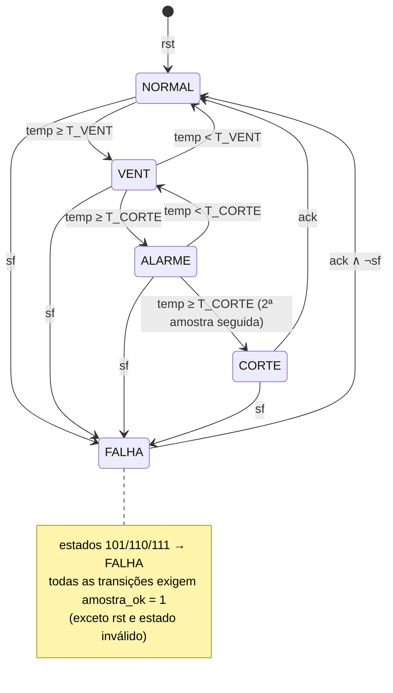

# FSM de intertravamento: tabela de transição

Modelo formal do bloco `intertravamento` (Etapa 3). Ele resolve as ambiguidades do roteiro conforme
o [Apêndice A de 02-arch.md](02-arch.md#apêndice-a-registro-de-decisões-do-roteiro) (D7 a D12). A implementação de referência
está em `ref/sentinela_ref.py` (`proximo_estado`, `Intertravamento`).

## Codificação e saídas (Moore)

| Estado | Código | vent | alarme | corte | falha_sensor |
|---|---|---|---|---|---|
| NORMAL | `000` | 0 | 0 | 0 | 0 |
| VENT | `001` | 1 | 0 | 0 | 0 |
| ALARME | `010` | 1 | 1 | 0 | 0 |
| CORTE | `011` | 1 | 1 | 1 | 0 |
| FALHA | `100` | 1 | 1 | 1 | 1 |
| *inválido* | `101` `110` `111` | 1 | 1 | 1 | 1 |

As saídas de cada estado são distintas. Por isso os vetores de teste identificam o estado só
pelas saídas, sem precisar de um pino de depuração.

## Sinais de condição

| Sinal | Definição |
|---|---|
| `ok` | `amostra_ok` (o `done` do fir4) |
| `ge_v` | `temp >= T_VENT` (0xB4) |
| `ge_c` | `temp >= T_CORTE` (0xD2) |
| `faixa` | `temp > T_FAIXA_MAX` (0xF0) |
| `igual` | `temp == anterior` (registrador com a amostra anterior) |
| `run_prox` | `igual ? min(run + 1, 15) : 1` (tamanho da sequência de amostras idênticas, incluindo a atual) |
| `congelado` | `run_prox >= N_CONGELADO` (8) |
| `sf` | `faixa OR congelado` (sensor_falho) |

Relações úteis para simplificar a lógica: `ge_c ⇒ ge_v` e `faixa ⇒ ge_c`.

Os registradores `anterior` (8 bits) e `run` (4 bits, saturante) só são atualizados quando
`ok = 1`. No reset, os dois vão para 0, e com isso a primeira amostra sempre resulta em `run = 1`,
qualquer que seja o seu valor.

## Tabela de transição

As linhas são avaliadas de cima para baixo dentro de cada estado: vale a primeira cuja condição
for verdadeira. "–" significa "qualquer valor".

| # | Estado atual | rst | ok | Condição | Próximo estado | Origem |
|---|---|---|---|---|---|---|
| 1 | qualquer | 1 | – | – | NORMAL | reset síncrono |
| 2 | 101, 110, 111 | 0 | – | – | FALHA | D12 (segurança) |
| 3 | qualquer válido | 0 | 0 | – | *mantém* | "uma decisão por amostra" |
| 4 | NORMAL | 0 | 1 | `sf` | FALHA | prioridade de segurança |
| 5 | NORMAL | 0 | 1 | `ge_v` | VENT | diagrama (D8) |
| 6 | NORMAL | 0 | 1 | senão | NORMAL | |
| 7 | VENT | 0 | 1 | `sf` | FALHA | caso 9 |
| 8 | VENT | 0 | 1 | `ge_c` | ALARME | diagrama |
| 9 | VENT | 0 | 1 | `ge_v` | VENT | |
| 10 | VENT | 0 | 1 | senão | NORMAL | diagrama |
| 11 | ALARME | 0 | 1 | `sf` | FALHA | |
| 12 | ALARME | 0 | 1 | `ge_c` | CORTE | "2 amostras seguidas ≥ T_CORTE" |
| 13 | ALARME | 0 | 1 | senão | VENT | caso 4 (D7) |
| 14 | CORTE | 0 | 1 | `sf` | FALHA | |
| 15 | CORTE | 0 | 1 | `ack` | NORMAL | caso 6 |
| 16 | CORTE | 0 | 1 | senão | CORTE | caso 5 |
| 17 | FALHA | 0 | 1 | `sf` | FALHA | `sf` vence o `ack` (D11) |
| 18 | FALHA | 0 | 1 | `ack` | NORMAL | |
| 19 | FALHA | 0 | 1 | senão | FALHA | |

## Diagrama (com as transições implícitas do roteiro)

## Controle microprogramado (alternativa b)

Para a versão com ROM, uma boa escolha de endereço é `{estado[2:0], sf, ge_c, ge_v, ack}`, com 7 bits
e 128 palavras. Deixe `ok` fora do endereço e use-o como *enable* do registrador de estado. Cada
palavra guarda o `próximo_estado[2:0]`, e as saídas podem vir de uma segunda ROM endereçada só
pelo estado (Moore). Para gerar o conteúdo, percorra os 128 endereços aplicando a tabela acima
(`proximo_estado()` no modelo tem a mesma lógica, mas recebe `temp` em vez das flags). Nos
endereços de combinações impossíveis (`ge_c ∧ ¬ge_v`) e de estados inválidos, coloque FALHA.
